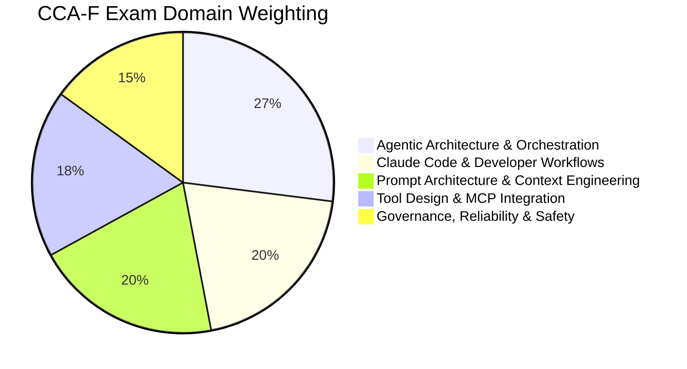
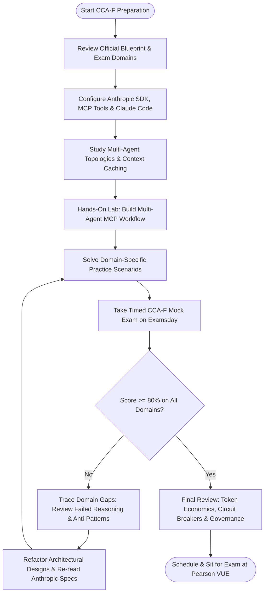
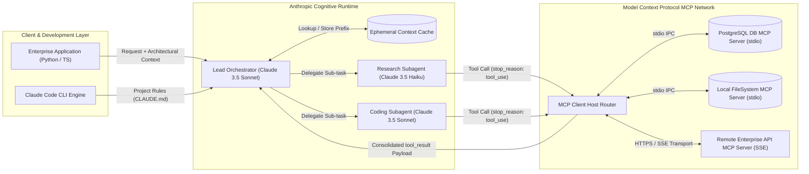
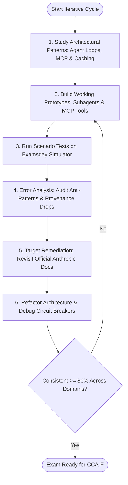
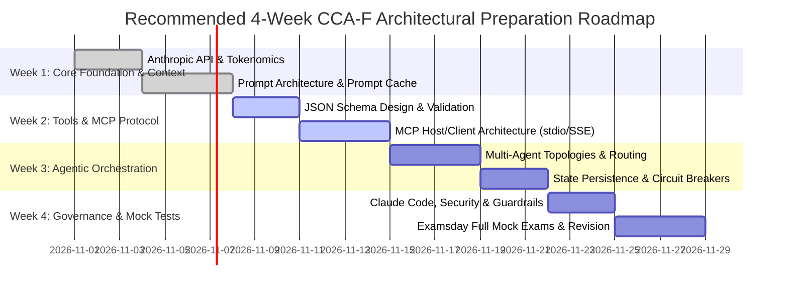

# Claude Certified Architect - Foundations (CCA-F) Study Guide & Resource Hub

An open-source, community-driven architectural study guide, blueprint breakdown, and scenario-based resource repository for the **Anthropic Claude Certified Architect - Foundations (CCA-F / CCAR-F)** certification examination.

This guide provides technical architectural references covering multi-agent orchestration, tool design and Model Context Protocol (MCP) integration, prompt architecture, context lifecycle management, governance, and enterprise reliability.

For realistic scenario-based mock exams, timed practice simulations, and detailed answer justifications, visit the [Examsday CCA-F Preparation Hub](https://examsday.com/exams/anthropic/cca-f).

---

## Table of Contents

- [1. Overview](#1-overview)
- [2. About the Certification](#2-about-the-certification)
- [3. Target Audience & Prerequisites](#3-target-audience--prerequisites)
- [4. Official Exam Objectives & Domain Breakdown](#4-official-exam-objectives--domain-breakdown)
- [5. Exam Domain Weightage](#5-exam-domain-weightage)
- [6. Certification Preparation Flowchart](#6-certification-preparation-flowchart)
- [7. Technical Architecture: Multi-Agent & MCP Enterprise Topology](#7-technical-architecture-multi-agent--mcp-enterprise-topology)
- [8. Circular Study & Revision Cycle](#8-circular-study--revision-cycle)
- [9. Step-by-Step Preparation Roadmap](#9-step-by-step-preparation-roadmap)
- [10. Scenario-Based Practice Questions](#10-scenario-based-practice-questions)
- [11. Common Architectural Pitfalls & Anti-Patterns](#11-common-architectural-pitfalls--anti-patterns)
- [12. Official & Independent Learning Resources](#12-official--independent-learning-resources)
- [13. About Examsday](#13-about-examsday)
- [14. Disclaimer](#14-disclaimer)

---

## 1. Overview

The Claude Certified Architect - Foundations (CCA-F) credential validates proficiency in architecting, orchestrating, and securing production-grade AI systems powered by Anthropic Claude. The exam emphasizes architectural judgment over syntax memorization—evaluating how engineers handle agent coordination, context budgeting, Model Context Protocol (MCP) security, and deterministic output validation.

| Metric | Specification |
| :--- | :--- |
| **Exam Code** | CCA-F (also referenced as CCAR-F) |
| **Full Title** | Claude Certified Architect - Foundations |
| **Provider** | Anthropic |
| **Target Role** | AI Architects, Lead Software Engineers, Solutions Architects |
| **Question Format** | 60 Scenario-Based Questions (Multiple Choice & Multiple Response) |
| **Exam Duration** | 120 Minutes |
| **Passing Score** | 720 / 1000 (Scaled Score) |
| **Delivery Method** | Online Proctored (Pearson VUE) / Authorized Testing Centers |
| **Practice Test Simulator** | [CCA-F Exam Simulator](https://examsday.com/exams/anthropic/cca-f) |

---

## 2. About the Certification

Anthropic's architectural certification evaluates an engineer's ability to transition from isolated API calls to comprehensive, distributed agentic systems. Rather than focusing merely on prompt wording, CCA-F tests architectural trade-offs: when to choose single-agent vs. multi-agent topologies, how to prevent tool call loops, how to enforce governance boundaries using structured schemas, and how to maintain provenance across chained LLM operations.

Earning the CCA-F demonstrates readiness to design secure enterprise AI solutions that operate reliably within real-world latency, cost, and safety constraints.

---

## 3. Target Audience & Prerequisites

### Intended Audience
- **Solutions & Cloud Architects**: Designing enterprise AI platforms, private MCP topologies, and integration pipelines across AWS Bedrock, Google Cloud Vertex AI, and direct Anthropic endpoints.
- **AI Systems Engineers**: Building autonomous agents, multi-agent orchestrators, and retrieval-augmented generation (RAG) architectures.
- **Technical Leads**: Establishing security controls, guardrails, context budget policies, and evaluation loops for production AI.

### Recommended Background
- Comprehensive understanding of distributed systems, REST APIs, JSON Schema, and asynchronous messaging.
- Hands-on experience with the Anthropic Messages API, Tool Calling protocol, and Model Context Protocol (MCP).
- Practical knowledge of token management, prefix-based prompt caching, and agent failure modes.

---

## 4. Official Exam Objectives & Domain Breakdown

The CCA-F blueprint evaluates five core architectural disciplines:

### Domain 1: Agentic Architecture & Orchestration (27%)
- Evaluating orchestration topologies: single-agent, router/dispatcher, orchestrator-subagent (hub-and-spoke), and evaluator-optimizer loops.
- Task decomposition and state handoff between specialized worker agents.
- Managing agent state persistence, session boundaries, and context window isolation.
- Designing deterministic exit conditions and circuit breakers to terminate execution loops.

### Domain 2: Tool Design & Model Context Protocol (MCP) Integration (18%)
- Designing granular, deterministic JSON schemas for tool inputs and error handling.
- MCP client-host-server topology: stdio for local processes vs. SSE (Server-Sent Events) for remote network microservices.
- Tool discovery, resource subscription, and security isolation across heterogeneous backend systems.
- Least-privilege access, credential segregation, and parameter validation.

### Domain 3: Claude Code Configuration & Developer Workflows (20%)
- Configuring enterprise coding environments with project-level memory via `CLAUDE.md`.
- Headless execution, automated CI/CD pipeline integration, and non-interactive workflows.
- Permission models, sandboxing execution environments, and human-in-the-loop approval barriers for destructive shell commands.

### Domain 4: Prompt Architecture & Structured Context Engineering (20%)
- Multi-tier system instructions, role assignment, and XML tag delimitation (`<context>`, `<guidelines>`, `<schema>`).
- Prefix-based prompt caching architecture (`cache_control: {"type": "ephemeral"}`) for dynamic multi-turn interactions.
- Structured output enforcement using synthetic JSON schema tools or constrained decoding patterns.
- Managing needle-in-a-haystack retrieval across 200k context windows with minimal dilution.

### Domain 5: Enterprise Governance, Reliability & Safety (15%)
- Defense-in-depth against prompt injection, jailbreaks, and indirect injection via untrusted tools.
- Observability and tracing: tracking token latency, cache hit ratios, and tool call histories.
- Fallback strategies: graceful degradation across Claude 3.5 Sonnet, Claude 3.5 Haiku, and Claude 3 Opus.
- Human escalation triggers and programmatic guardrails for regulatory compliance.

---

## 5. Exam Domain Weightage

| Domain | Area of Focus | Weighting |
| :---: | :--- | :---: |
| **Domain 1** | Agentic Architecture & Orchestration | 27% |
| **Domain 2** | Claude Code Configuration & Developer Workflows | 20% |
| **Domain 3** | Prompt Architecture & Structured Context Engineering | 20% |
| **Domain 4** | Tool Design & Model Context Protocol (MCP) Integration | 18% |
| **Domain 5** | Enterprise Governance, Reliability & Safety | 15% |

---

## 6. Certification Preparation Flowchart

---

## 7. Technical Architecture: Multi-Agent & MCP Enterprise Topology

---

## 8. Circular Study & Revision Cycle

---

## 9. Step-by-Step Preparation Roadmap

### Week-by-Week Preparation Milestones

- **Week 1: Core Foundation & Context Architecture**
  - Master the Messages API parameter matrix (`model`, `temperature`, `max_tokens`, `system`, `stop_sequences`).
  - Implement Anthropic Prompt Caching with `cache_control: {"type": "ephemeral"}` at exact prefix boundaries.
  - Structure complex system instructions using XML tags (`<system_instructions>`, `<rules>`, `<context>`).

- **Week 2: Tools & Model Context Protocol (MCP)**
  - Build custom MCP servers over `stdio` and `SSE` transport layers.
  - Define explicit JSON Schemas to prevent hallucinated argument structures.
  - Implement security sandboxing for local tool execution.

- **Week 3: Agentic Orchestration & Reliability**
  - Implement orchestrator-worker, router-evaluator, and sequential chain topologies.
  - Design deterministic termination rules, token thresholds, and loop-detection circuit breakers.
  - Maintain data provenance and source citation metadata across multi-turn handoffs.

- **Week 4: Enterprise Governance, Claude Code & Final Practice**
  - Configure `CLAUDE.md` to establish project standards and tool permissions.
  - Implement defense-in-depth against prompt injection and data exfiltration.
  - Complete full-length timed mock exams on [Examsday](https://examsday.com/exams/anthropic/cca-f) to calibrate pacing and scenario judgment.

---

## 10. Scenario-Based Practice Questions

### Question 1: Preserving Data Provenance Across Multi-Agent Pipelines
**Scenario:**
You are architecting an enterprise intelligence platform using Claude 3.5 Sonnet. A research orchestrator decomposes an analytical query and delegates tasks to a Web Search Subagent and an Internal Document Subagent. A Synthesis Agent receives the findings, produces a summary, and passes it to a final Report Generator.

During pilot testing, the final reports contain factual claims without citations; the Report Generator cannot attribute statements to source documents because metadata was lost during intermediate summarization.

Which architectural modification most effectively guarantees source attribution in final outputs?

- A) Require the Report Generator to re-query the Web Search Subagent to locate original citations before generating the final text.
- B) Mandate that each subagent return structured JSON separating content summaries from explicit metadata arrays (URLs, document titles, version IDs, page numbers).
- C) Eliminate intermediate summarization and forward the entire raw context of all retrieved documents directly to the Report Generator.
- D) Instruct the Synthesis Agent in natural language to embed inline markdown links directly inside its conversational text blocks.

<b>View Answer & Explanation</b>

**Correct Answer:** **B**

**Detailed Explanation:**
Passing structured JSON that isolates data payloads from metadata preserves provenance as information transitions across multi-agent boundaries. By decoupling content from metadata attributes (e.g., document ID, URL, timestamp, author), downstream agents can synthesize insights while maintaining exact traceability to reference sources.

- **Option A is incorrect** because re-running search queries introduces redundant latency, multiplies token costs, and risks retrieving inconsistent search results.
- **Option C is incorrect** because passing raw outputs directly causes context window bloat, increases cost, and degrades retrieval precision due to context dilution.
- **Option D is incorrect** because freeform inline markdown links can be hallucinated, truncated, or dropped during downstream summarization passes.

---

### Question 2: Model Context Protocol (MCP) Transport and Security Isolation
**Scenario:**
An enterprise engineering team needs an AI assistant running in a local developer environment to inspect internal PostgreSQL databases hosted within an isolated private VPC. The security architecture team mandates that database credentials must never reside on the local workstations, and raw connection strings must never be exposed to the client application.

How should this architecture be configured using Model Context Protocol (MCP) standards?

- A) Deploy an MCP Server inside the private VPC exposing query tools over Server-Sent Events (SSE) with mutual TLS authentication, and configure the local developer workstation as an MCP Client.
- B) Implement an MCP Server on each local developer machine communicating via `stdio`, storing encrypted database credentials in the local environment variables.
- C) Pass database connection strings directly in the system instructions of the Anthropic Messages API payload, requesting that Claude perform direct network queries.
- D) Run an MCP Client in the private VPC that polls the local developer workstation over WebSockets to retrieve queries.

<b>View Answer & Explanation</b>

**Correct Answer:** **A**

**Detailed Explanation:**
In the Model Context Protocol architecture, an **MCP Server** runs in the environment where the target data or execution runtime lives. Hosting an MCP Server inside the private VPC over SSE (Server-Sent Events) with mTLS enables local developer workstations (acting as MCP Clients) to invoke predefined tools without ever having access to database credentials or internal connection strings.

- **Option B is incorrect** because it violates the security mandate by placing database credentials on local workstations.
- **Option C is incorrect** because Anthropic cloud models do not execute network socket connections directly to user infrastructure.
- **Option D is incorrect** because the client initiates tool discovery and invocation toward the server, not vice versa.

---

### Question 3: Optimizing Latency and Cost with Prefix Prompt Caching
**Scenario:**
An organization deploys a customer support agent on Claude 3.5 Sonnet. Every incoming request must adhere to a 45,000-token corporate policy manual, a 15-tool JSON schema definition, and dynamic user conversation history that updates every turn.

To ensure consistent prompt cache hits across subsequent conversational turns, how must the message structure be configured?

- A) Place dynamic conversation history first, followed by the tool schemas, and place the 45,000-token policy manual at the very end of the message payload with `"cache_control": {"type": "ephemeral"}`.
- B) Place the static 45,000-token policy manual and static tool schemas at the top of the request (in `system` or early `user` blocks) marked with `"cache_control": {"type": "ephemeral"}`, followed by dynamic conversation turns.
- C) Set `"cache_control": {"type": "ephemeral"}` on every single message turn in the message array.
- D) Re-order the conversation history alphabetically before each API call to normalize the prefix.

<b>View Answer & Explanation</b>

**Correct Answer:** **B**

**Detailed Explanation:**
Anthropic Prompt Caching relies on exact prefix matching. The cache checks the prompt starting from the very first token. By placing large static content (system instructions, corporate policies, tool definitions) at the beginning of the prompt with a cache breakpoint (`"type": "ephemeral"`), all subsequent turns that append new user/assistant messages will reuse the cached prefix, yielding up to a 90% cost reduction and significant latency improvements.

- **Option A is incorrect** because placing dynamic messages ahead of static content alters the initial tokens on every turn, invalidating the prefix and causing continuous cache misses.
- **Option C is incorrect** because Anthropic permits up to 4 cache breakpoints per request; marking every message is invalid and counterproductive.
- **Option D is incorrect** because reordering conversation turns breaks conversational context and alters prompt prefixes arbitrarily.

---

## 11. Common Architectural Pitfalls & Anti-Patterns

1. **Unbounded Agent Loops**
   Allowing an autonomous agent to call tools iteratively without a strict maximum iteration counter (`max_iterations = 10`) or token budget can lead to runaway API spend during error states. Always implement a programmatic circuit breaker.
2. **Context Dilution via Excessive Document Packing**
   Stuffing entire document libraries into a single prompt degrades Claude's reasoning efficiency. Use a hybrid RAG pipeline or dynamic subagent filtering to supply only high-relevance chunks.
3. **Monolithic Multi-Tool Configurations**
   Providing a single agent with 30+ disparate tools degrades tool selection accuracy. Partition tools into focused subagents (e.g., Database Agent, Billing Agent, Communications Agent) coordinated by a lean router.
4. **Neglecting Ephemeral Cache Invalidation**
   Modifying a single character in the system prompt or tool schema preceding a cached block causes an immediate cache miss across all subsequent tokens. Keep cached prefixes strictly static.

---

## 12. Official & Independent Learning Resources

### Official Anthropic Resources
- [Anthropic Messages API Documentation](https://docs.anthropic.com/en/api/getting-started)
- [Model Context Protocol (MCP) Specification](https://modelcontextprotocol.io/)
- [Anthropic Prompt Engineering Tutorial](https://github.com/anthropics/prompt-eng-interactive-tutorial)
- [Anthropic Prompt Caching Guide](https://docs.anthropic.com/en/docs/build-with-claude/prompt-caching)
- [Claude Code Setup & CLI Architecture](https://docs.anthropic.com/en/docs/agents-and-tools/claude-code)

### Practice & Assessment Portals
- [Examsday CCA-F Practice Exam Simulator](https://examsday.com/exams/anthropic/cca-f): Comprehensive question bank, timed mock tests, and domain-level analytics.
- [Examsday Certification Portal](https://examsday.com/): Interactive test engines and architectural study hubs.

---

## 13. About Examsday

[Examsday](https://examsday.com/) is an Official technical certification preparation platform offering high-fidelity mock exams, scenario simulations, and deep architectural rationales.

Examsday practice resources focus on real-world engineering decisions: evaluating trade-offs, auditing security guardrails, and navigating production failure modes. Combining hands-on implementation with timed scenario practice builds the diagnostic reasoning required to succeed on exam day.
